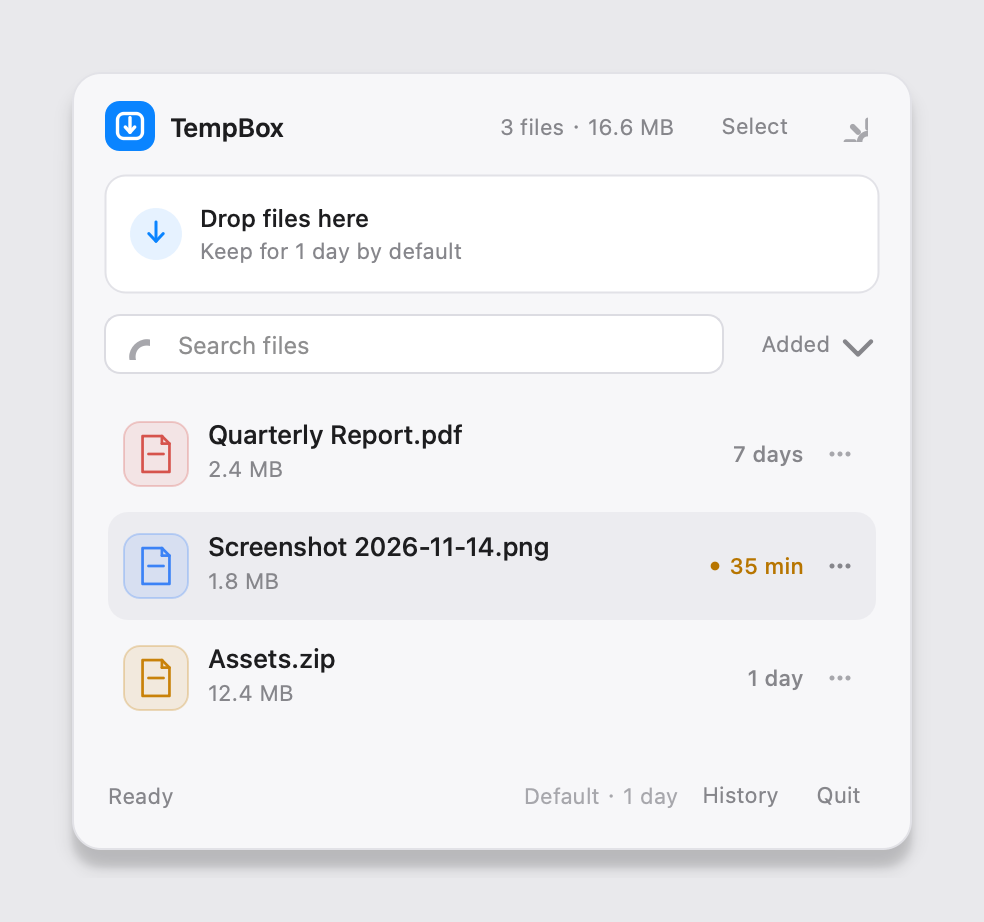
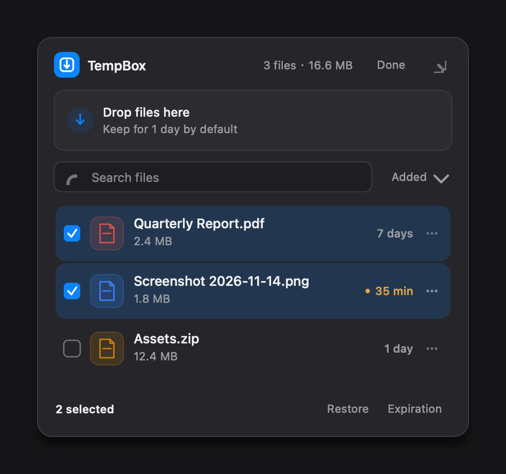
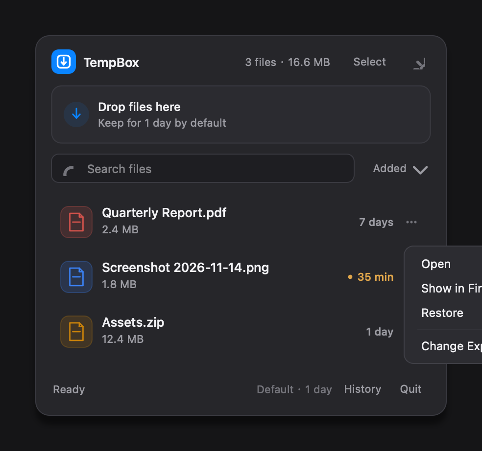

# TempBox

**Temporary files deserve a temporary home.**

English | [简体中文](README.zh-CN.md)

TempBox is a lightweight macOS menu bar app for files that should not live on the
Desktop forever. Drop a file into the floating panel, choose how long to keep it, and
TempBox stores it in its own folder until it is automatically moved to the macOS
Trash. Files can be opened, revealed in Finder, restored, or given a new deadline at
any time.

## Download

**TempBox 1.0.0 · Apple Silicon (arm64)**

- [Download TempBox v1.0.0](https://github.com/giaoWH/tempbox/releases/tag/v1.0.0)
- Asset: `TempBox-1.0.0-macOS-arm64.dmg`
- SHA-256: `4eaa943d6b67d4017aaf156a92959a3324c7abc99a07e7dc12d5ec3ac11534db`

> **Important:** this build is **not notarized or Developer ID signed**. It may be
> blocked by macOS Gatekeeper on first launch. Only download from the official
> GitHub repository and verify the SHA-256 checksum published with the release.
> Installation steps are below.


## Install the macOS app (unsigned build)

1. Download `TempBox-1.0.0-macOS-arm64.dmg` from the official GitHub Release.
2. Open the DMG and drag **TempBox.app** to **Applications**.
3. Try to open TempBox. If macOS says the app cannot be verified, do **not** disable
   Gatekeeper or SIP. Instead, open **System Settings → Privacy & Security**, find
   TempBox in the security notice, and use **Open Anyway**. Alternatively,
   Control-click/right-click TempBox in Finder and choose **Open** once. See Apple's
   official guidance: <https://support.apple.com/guide/mac-help/mh40616/mac>.
4. The app has no Dock icon; look for the TempBox icon in the menu bar.

TempBox requires **Apple Silicon (arm64)**. An Intel build, Developer ID signing and
Apple notarization are not part of v1.0.0.

## Why TempBox

- **A real home for temporary files.** They are not hidden on the Desktop or mixed
  into Downloads.
- **Nothing is permanently deleted.** Expired files go to the macOS Trash.
- **Safe by default.** TempBox only cleans files it manages, inside its own storage.
- **Low friction.** A compact panel, Finder drag-and-drop, batch actions and a Finder
  Quick Action keep everyday use quick.
- **Quiet and native.** No Dock icon, no account, no cloud, no background daemon
  beyond the running menu bar app.

## Features

- Compact floating panel opened from the menu bar icon.
- Drag files from Finder into the panel; single and multiple files supported.
- Default retention (1 day unless changed), plus per-file presets and custom times.
- Automatic expiry cleanup to the macOS Trash, with startup catch-up.
- Pause/resume automatic cleanup. Pause is persistent, and resuming asks before
  cleaning an existing backlog.
- Search, sort by Added / Name / Size / Expires, and multi-select batch restore or
  expiry changes.
- Open in default app, Show in Finder, restore to a chosen folder when needed.
- Recently cleaned history (metadata only, up to 100 entries) with manual clear.
- Expiry reminders 10 minutes before a file is due (toggleable; batch-aware).
- Finder Quick Action: **Move to TempBox** (installed from Settings).
- Launch at login via a per-user LaunchAgent.
- Follows the system light/dark appearance.
- User-triggered **Check for Updates** using GitHub Releases; no background checks,
  automatic downloads or silent installs.

More detail: [User guide](docs/USAGE.md) · [Development guide](docs/DEVELOPMENT.md) ·
[Release notes](docs/RELEASE_NOTES_v1.0.0.md) · [Changelog](CHANGELOG.md) ·
[Contributing](CONTRIBUTING.md).

## Requirements

**Installed app**

- macOS on Apple Silicon (developed and tested on macOS 27.0.1, arm64)
- No Python, Conda or PySide6 installation is required.

**Building/running from source**

- Conda (Miniconda or Anaconda)
- Python 3.14 (verified 3.14.10)
- PySide6 6.12.0, Send2Trash 2.2.0
- PyInstaller 6.22.3 (only for building the app)

## Run or build from source

```bash
git clone https://github.com/giaoWH/tempbox.git
cd tempbox
conda env create -f environment.yml
conda activate tempbox
python main.py
```

If `conda env create` fails with `CondaToSNonInteractiveError` because the Anaconda
`defaults` channel terms have not been accepted, use the explicit setup in
[docs/DEVELOPMENT.md](docs/DEVELOPMENT.md).

To build the `.app` and `.dmg`:

```bash
conda activate tempbox
python -m pip install -r requirements-build.txt
PYTHON="$CONDA_PREFIX/bin/python" ./scripts/build_macos.sh
```

Outputs: `dist/TempBox.app` and `dist/TempBox-1.0.0-macOS-arm64.dmg`.

`python main.py --hidden` starts only the menu bar icon (used for login launch). The
full build and test instructions are in [docs/DEVELOPMENT.md](docs/DEVELOPMENT.md).

## Quick usage

Click the menu bar icon to open the panel. Drag files in; they use the current default
retention. Use a row's `···` menu to open, reveal, restore or change its expiry. Click
**Select** for batch actions. Open the gear for default retention, pause, reminders,
Finder Quick Action, About and Check for Updates.

Expired files are moved to the macOS Trash, never deleted permanently. When TempBox is
not running, cleanup happens at the next launch; pausing cleanup is respected across
launches. Full instructions: [docs/USAGE.md](docs/USAGE.md).

### Finder Quick Action

Settings → **Install Finder Quick Action** creates `Move to TempBox.workflow` in
`~/Library/Services` and refreshes the macOS Services cache. Then right-click selected
files in Finder → **Quick Actions** (or **Services**) → **Move to TempBox**. If it is
not visible, reopen Finder or enable it in System Settings → Keyboard → Keyboard
Shortcuts → Services. Reinstall the Quick Action if you move the `.app`.

### Updates

Settings → **About TempBox → Check for Updates…** queries the GitHub Releases API only
when you ask. It reports up to date, a newer release, no published release, rate
limiting or network errors. It never downloads or installs an update automatically.

## File safety

TempBox stores managed files under
`~/Library/Application Support/TempBox/files/<uuid>/<original-name>`, with a
`records.json` index and `settings.json` preferences. Cleanup:

- only considers files recorded by TempBox and inside TempBox storage;
- only moves regular files whose own expiry has passed;
- uses `Send2Trash`, so files remain recoverable in the Trash;
- keeps the file and record if the Trash move fails, and retries later;
- never treats a missing file as cleaned;
- serializes index changes across the app and Finder Quick Action with a file lock.

Missing or unknown metadata is never used to delete arbitrary files. The cleanup
history, reminders and update checks never perform file deletion themselves. See
[docs/DEVELOPMENT.md](docs/DEVELOPMENT.md) for the data format.

## Screenshots

| Dark panel | Light panel |
| --- | --- |
|  |  |
| **Multi-select** | **File actions** |
|  |  |

## Project status

| Phase | Focus | Version |
|---|---|---|
| 1 | Basic file management | v0.1 |
| 2 | Retention and Trash lifecycle | v0.2 |
| 3 | Search, batch actions, login launch | v0.3 |
| 3.5 | Floating panel UI and integration | v0.3.5 |
| 4 | Finder Quick Action, history, pause, reminders | v0.4 |
| 4.5 | Refactoring, project cleanup, documentation | v0.5 |
| 5 | Apache-2.0, packaging, DMG, update checks | v1.0.0 |

Developer ID signing, notarization, Intel builds and a fully signed installation
experience are future work, not claims about this release. See
[CHANGELOG.md](CHANGELOG.md).

## License

TempBox's own source code is licensed under the **Apache License 2.0**. See
[LICENSE](LICENSE) and [NOTICE](NOTICE). Third-party components retain their own
licenses — notably PySide6/Qt (LGPL-3.0 option), Python (PSF), Send2Trash (BSD-3-
Clause) and the PyInstaller bootloader (GPL-2.0 with the PyInstaller Bootloader
Exception). See [THIRD_PARTY_LICENSES.md](THIRD_PARTY_LICENSES.md) and the
[`licenses/`](licenses/) directory.

Apache-2.0 does **not** replace third-party licenses.

## Feedback and contributions

- Issues: <https://github.com/giaoWH/tempbox/issues>
- Contributing: [CONTRIBUTING.md](CONTRIBUTING.md)
- The app is provided without Apple notarization in v1.0.0; please report security or
  data-loss issues with reproduction steps and a description of the affected file
  flow. Never attach real personal files.
