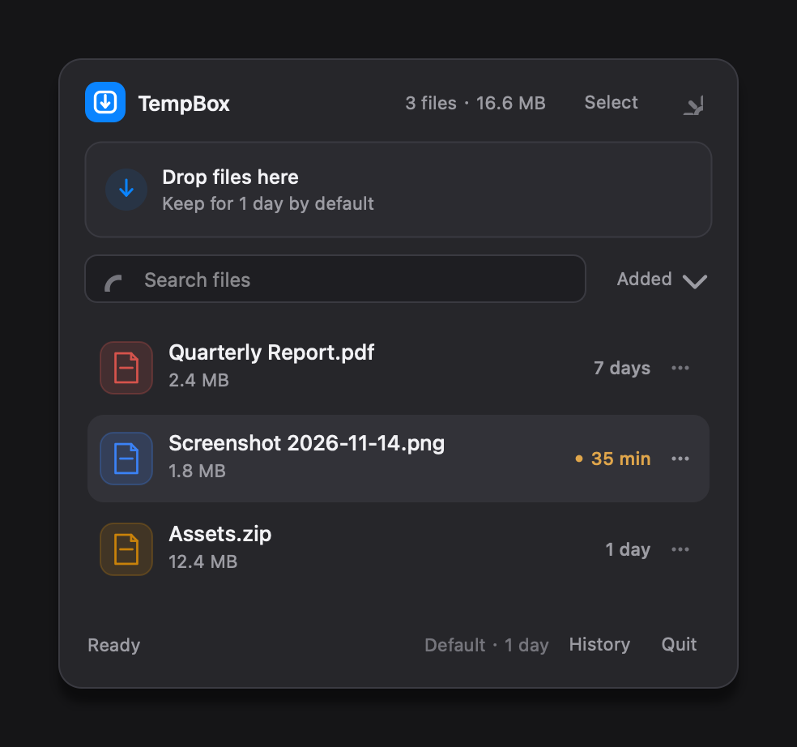

# TempBox

**Temporary files deserve a temporary home.**

TempBox is a lightweight macOS menu bar app for files that should not live on the
Desktop forever. Drop a file into the floating panel, choose how long to keep it, and
TempBox stores it in its own folder until it is automatically moved to the macOS
Trash. Files can be opened, revealed in Finder, restored, or given a new deadline at
any time.

The project is currently in **Phase 4.5 (v0.5.0)**. It runs from a Python/Conda
environment; a packaged, signed `.app` and public release are planned for Phase 5.



## Why TempBox

- **A real home for temporary files.** They are not hidden on the Desktop or mixed
  into Downloads.
- **Nothing is permanently deleted.** Expired files go to the macOS Trash.
- **Safe by default.** TempBox only cleans files it manages, inside its own storage.
- **Low friction.** A compact panel, Finder drag-and-drop, batch actions and a Finder
  Quick Action keep everyday use quick.
- **Quiet and native.** No Dock icon, no account, no cloud, no background daemon
  beyond the running menu bar app.

## Features

- Compact floating panel opened from the menu bar icon.
- Drag files from Finder into the panel; single and multiple files supported.
- Default retention (1 day unless changed), plus per-file presets and custom times.
- Automatic expiry cleanup to the macOS Trash, with startup catch-up.
- Pause/resume automatic cleanup. Pause is persistent, and resuming asks before
  cleaning an existing backlog.
- Search, sort by Added / Name / Size / Expires, and multi-select batch restore or
  expiry changes.
- Open in default app, Show in Finder, Restore to a chosen folder when needed.
- Recently cleaned history (metadata only, up to 100 entries) with manual clear.
- Expiry reminders 10 minutes before a file is due (toggleable; batch-aware).
- Finder Quick Action: **Move to TempBox** (installed from Settings).
- Launch at login via a per-user LaunchAgent.
- Follows the system light/dark appearance.
- Built-in update-check entry with the current version; update checking is not yet
  enabled in this development build.

More detail: [User guide](docs/USAGE.md) · [Development guide](docs/DEVELOPMENT.md) ·
[Changelog](CHANGELOG.md) · [Contributing](CONTRIBUTING.md).

## Requirements

- macOS (developed and tested on macOS 27.0.1, Apple Silicon)
- Conda (Miniconda or Anaconda)
- Python 3.14 (verified with 3.14.10)
- PySide6 6.12.0, Send2Trash 2.2.0

TempBox is currently a development build. There is no public `.app` installer yet.

## Run from source

```bash
git clone <repository-url>
cd tempbox
conda env create -f environment.yml
conda activate tempbox
python main.py
```

If `conda env create` fails with `CondaToSNonInteractiveError` because the Anaconda
`defaults` channel terms have not been accepted, use the explicit pip setup in
[docs/DEVELOPMENT.md](docs/DEVELOPMENT.md).

Use `python main.py --hidden` for a menu-bar-only start (this is what login launch
uses). See [docs/DEVELOPMENT.md](docs/DEVELOPMENT.md) for tests and project layout.

## Quick usage

Click the menu bar icon to open the panel. Drag files in; they use the current default
retention. Use a row's `···` menu to open, reveal, restore or change its expiry. Click
**Select** for batch actions. Open the gear for default retention, pause, reminders,
Finder Quick Action and About.

Expired files are moved to the macOS Trash, never deleted permanently. When TempBox is
not running, cleanup happens at the next launch; pausing cleanup is respected across
launches. Full instructions: [docs/USAGE.md](docs/USAGE.md).

### Finder Quick Action

Settings → **Install Finder Quick Action** creates `Move to TempBox.workflow` in
`~/Library/Services` and refreshes the macOS Services cache. Then right-click selected
files in Finder → **Quick Actions** (or **Services**) → **Move to TempBox**. If it is
not visible, reopen Finder or enable it in System Settings → Keyboard → Keyboard
Shortcuts → Services.

### Menu bar icon drag

Dragging onto the menu bar icon itself is **not supported** by the current PySide6
`QSystemTrayIcon` implementation. Use the floating panel for drag-and-drop; this is a
deliberate decision to avoid unstable native status-item bridging.

## File safety

TempBox stores managed files under
`~/Library/Application Support/TempBox/files/<uuid>/<original-name>`, with a
`records.json` index and `settings.json` preferences. Cleanup:

- only considers files recorded by TempBox and inside TempBox storage;
- only moves regular files whose own expiry has passed;
- uses `Send2Trash`, so files remain recoverable in the Trash;
- keeps the file and record if the Trash move fails, and retries later;
- never treats a missing file as cleaned;
- serializes index changes across the app and Finder Quick Action with a file lock.

Missing or unknown metadata is never used to delete arbitrary files. The cleanup
history and reminders never perform file deletion themselves. See
[docs/DEVELOPMENT.md](docs/DEVELOPMENT.md) for the data format.

## Screenshots

| Dark panel | Light panel |
| --- | --- |
|  |  |
| **Multi-select** | **File actions** |
|  |  |

## Project status

| Phase | Focus | Version |
|---|---|---|
| 1 | Basic file management | v0.1 |
| 2 | Retention and Trash lifecycle | v0.2 |
| 3 | Search, batch actions, login launch | v0.3 |
| 3.5 | Floating panel UI and integration | v0.3.5 |
| 4 | Finder Quick Action, history, pause, reminders | v0.4 |
| 4.5 | Refactoring, project cleanup, documentation | v0.5 |

**Not in this repository yet:** packaged `.app`/`.dmg`, code signing and
notarization, GitHub Releases and live update checks, final app icon.

### Roadmap

- **Phase 5:** app icon, `.app`/`.dmg` packaging, signing and notarization, GitHub
  Releases, a live update checker, and packaged validation of Finder Quick Action
  registration and Notification Center delivery. No date is promised yet.

## License

A license has not been chosen yet. The intended options for a small utility like this
are MIT or Apache-2.0; the repository owner should confirm before the first public
release. Until then, treat the code as all-rights-reserved. See
[CONTRIBUTING.md](CONTRIBUTING.md).
