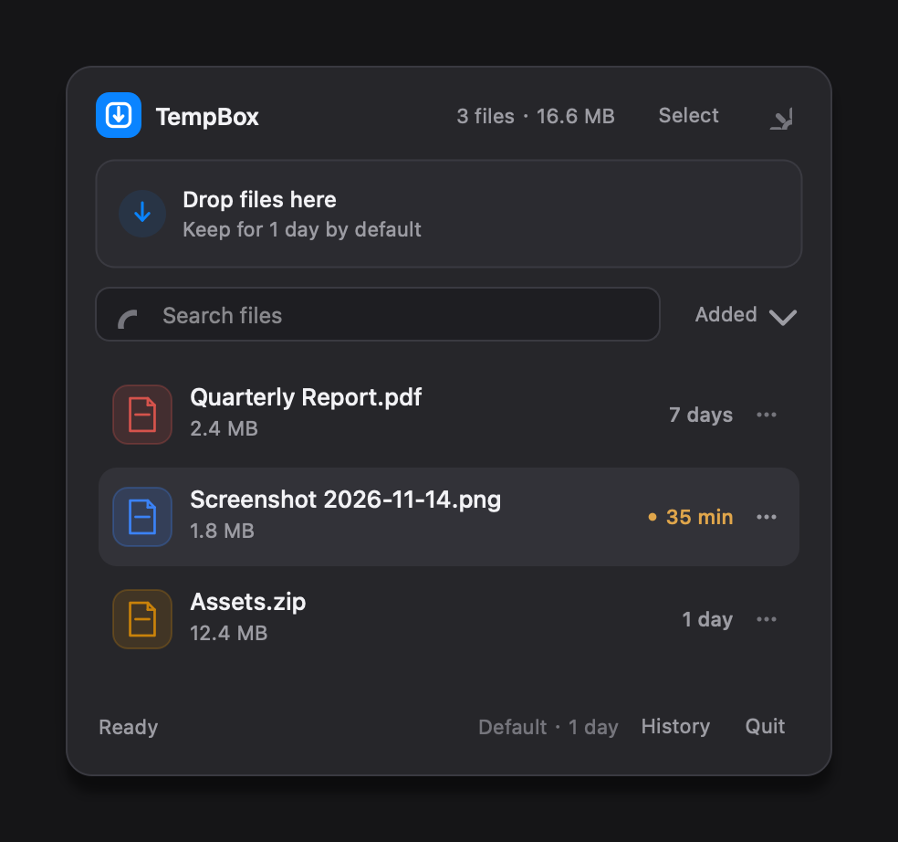
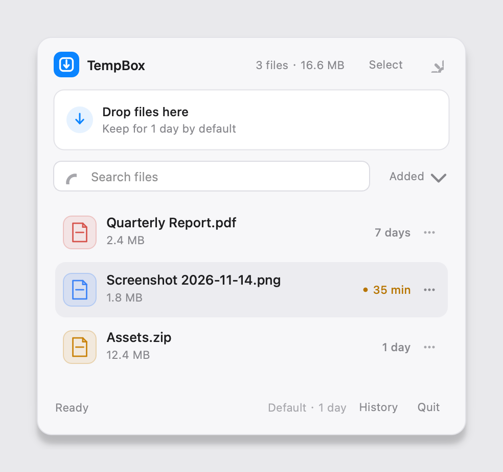
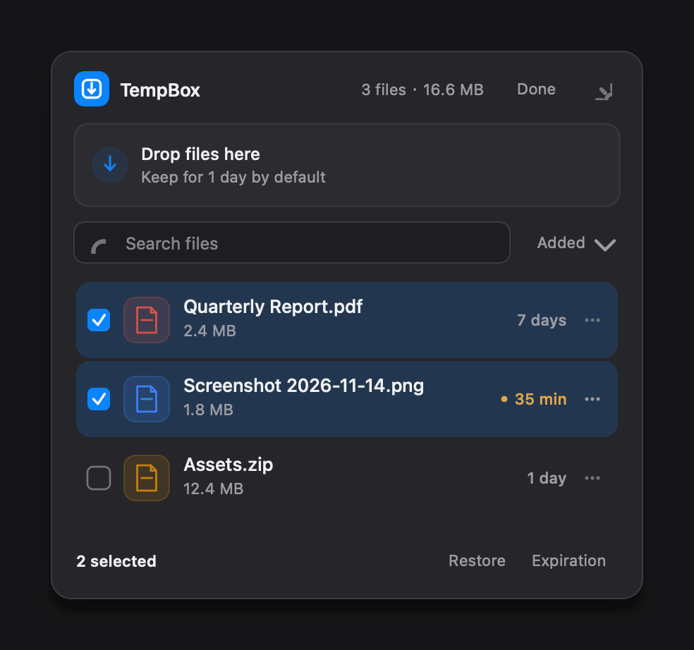
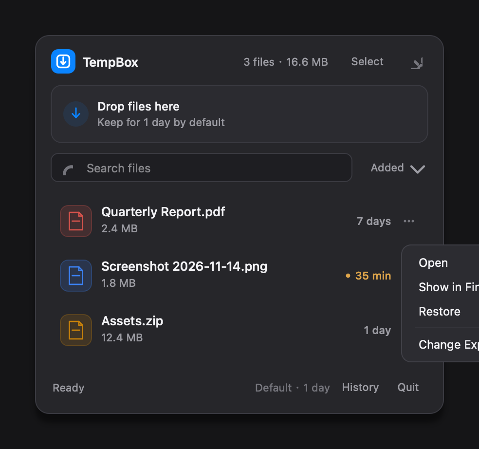

# TempBox

**临时文件，值得一个临时的家。**

[English](README.md) | 简体中文

TempBox 是一款轻量的 macOS 菜单栏工具，专门收纳那些不该长期堆在桌面上的临时文件。把文件拖进悬浮面板，设置保留期限，TempBox 会把它放进自己的存储目录；到期后自动移入 macOS 废纸篓。文件随时可以打开、在 Finder 中定位、取回，或重新设置到期时间。

## 下载

**TempBox 1.0.0 · Apple Silicon (arm64)**

- [下载 TempBox v1.0.0](https://github.com/giaoWH/tempbox/releases/tag/v1.0.0)
- 文件：`TempBox-1.0.0-macOS-arm64.dmg`
- SHA-256：`4eaa943d6b67d4017aaf156a92959a3324c7abc99a07e7dc12d5ec3ac11534db`

> **重要：** 此构建**没有经过 Apple 公证，也没有 Developer ID 签名**。首次启动可能被 macOS Gatekeeper 阻止。请只从官方 GitHub 仓库下载，并核对 Release 中提供的 SHA-256 校验值。安装步骤见下方。



## 安装未公证的 macOS 应用

1. 从官方 GitHub Release 下载 `TempBox-1.0.0-macOS-arm64.dmg`。
2. 打开 DMG，将 **TempBox.app** 拖入 **Applications**。
3. 首次打开。如果 macOS 提示无法验证应用，**不要**关闭 Gatekeeper 或 SIP。请打开 **系统设置 → 隐私与安全性**，在安全提示中找到 TempBox 并选择 **仍要打开**；也可以在 Finder 中按住 Control 点击 TempBox，选择 **打开**。Apple 官方说明：<https://support.apple.com/guide/mac-help/mh40616/mac>。
4. TempBox 没有 Dock 图标；请在菜单栏中寻找 TempBox 图标。

TempBox v1.0.0 需要 **Apple Silicon (arm64)**。本版本不提供 Intel 构建、Developer ID 签名或 Apple 公证。

## 为什么是 TempBox

- **给临时文件一个真正的归宿。** 不藏在桌面，也不混进“下载”文件夹。
- **永远不会被永久删除。** 过期文件进入 macOS 废纸篓，仍可恢复。
- **默认安全。** 只处理 TempBox 自己管理、位于其存储目录内的文件。
- **操作成本低。** 紧凑面板、Finder 拖拽、批量操作和 Finder 快速操作覆盖日常使用。
- **安静、原生。** 没有 Dock 图标，没有账号、云同步或常驻后台守护进程。

## 功能

- 点击菜单栏图标打开紧凑悬浮面板。
- 从 Finder 拖入单个或多个文件。
- 默认保留期限（初始为 1 天），支持单个文件的预设和自定义时间。
- 到期自动移入 macOS 废纸篓；启动时补做过期检查。
- 暂停/恢复自动清理；暂停状态持久化，恢复时若有积压文件会先询问。
- 按添加时间、名称、大小、到期时间搜索和排序。
- 多选后批量取回或批量修改期限。
- 在默认应用中打开、在 Finder 中定位、取回到原位置或指定文件夹。
- 最近清理历史（仅元数据，最多 100 条），可手动清空。
- 文件到期前 10 分钟提醒（可关闭；多个文件合并提醒）。
- Finder 快速操作 **Move to TempBox**（在设置中安装）。
- 通过 LaunchAgent 登录启动。
- 跟随系统浅色/深色外观。
- 用户主动触发的 **检查更新**（GitHub Releases）；没有后台检查，也不会自动下载或静默安装。

更多说明：[使用指南](docs/USAGE.zh-CN.md) · [开发指南](docs/DEVELOPMENT.zh-CN.md) · [发布说明](docs/RELEASE_NOTES_v1.0.0.zh-CN.md) · [变更记录](CHANGELOG.zh-CN.md) · [贡献指南](CONTRIBUTING.zh-CN.md)。

## 环境要求

**安装版应用**

- macOS，Apple Silicon（开发和测试环境：macOS 27.0.1，arm64）
- 无需安装 Python、Conda 或 PySide6。

**从源码运行/构建**

- Conda / Miniconda
- Python 3.14（验证版本 3.14.10）
- PySide6 6.12.0、Send2Trash 2.2.0
- PyInstaller 6.22.3（仅构建应用时需要）

## 从源码运行或构建

```bash
git clone https://github.com/giaoWH/tempbox.git
cd tempbox
conda env create -f environment.yml
conda activate tempbox
python main.py
```

如果 `conda env create` 因 Anaconda `defaults` 频道条款未接受而报 `CondaToSNonInteractiveError`，请使用 [开发指南](docs/DEVELOPMENT.zh-CN.md) 中不经过 `defaults` 频道的显式安装命令。

构建 `.app` 和 `.dmg`：

```bash
conda activate tempbox
python -m pip install -r requirements-build.txt
PYTHON="$CONDA_PREFIX/bin/python" ./scripts/build_macos.sh
```

输出：`dist/TempBox.app` 和 `dist/TempBox-1.0.0-macOS-arm64.dmg`。

`python main.py --hidden` 仅启动菜单栏图标（登录启动使用）。完整构建和测试说明见 [开发指南](docs/DEVELOPMENT.zh-CN.md)。

## 快速使用

点击菜单栏图标打开面板，把文件拖入即可，文件使用当前默认期限。文件行右侧的 `···` 菜单可以打开、定位、取回或修改期限；点击 **Select** 进入多选批量操作；齿轮按钮打开设置，包括默认期限、暂停、提醒、Finder 快速操作、关于和检查更新。

到期文件会移入 macOS 废纸篓，不会被永久删除。TempBox 未运行时，过期清理会在下次启动时进行；暂停状态在重启后仍然有效。完整说明见 [使用指南](docs/USAGE.zh-CN.md)。

### Finder 快速操作

设置 → **Install Finder Quick Action** 会在 `~/Library/Services` 中创建 `Move to TempBox.workflow`，并刷新 macOS 服务缓存。之后在 Finder 中选中文件 → 右键 → **Quick Actions**（或 **Services**）→ **Move to TempBox**。

如果菜单项没有出现：

- 重新打开 Finder 窗口，或重启 Finder；
- 同时检查右键菜单中的 **Quick Actions** 和 **Services**；
- 在系统设置 → 键盘 → 键盘快捷键 → 服务中启用 **Move to TempBox**（部分 macOS 版本位于“通用 → 登录项与扩展”）。

移动 `.app` 后需要重新安装 Quick Action。

### 检查更新

设置 → **About TempBox → Check for Updates…** 只在你主动点击时查询 GitHub Releases API。它会显示已是最新版本、发现新版本、暂无正式 Release、限流或网络错误/API 错误；不会自动下载、替换或静默安装。

## 文件安全

TempBox 管理的文件位于：

```text
~/Library/Application Support/TempBox/files/<uuid>/<原始文件名>
```

索引为 `records.json`，设置为 `settings.json`。清理规则：

- 只考虑 TempBox 记录中、位于 TempBox 存储目录内的文件；
- 只处理普通文件，且只处理自身到期时间已过的文件；
- 使用 `Send2Trash` 移入废纸篓，可恢复；
- 废纸篓操作失败时保留文件和记录，稍后重试；
- 文件缺失只报告，不当作清理成功；
- App 与 Finder 快速操作通过文件锁串行写入索引，避免互相覆盖。

缺失或未知的元数据绝不会被用于删除任意文件。清理历史、提醒和更新检查本身不删除文件。数据格式详见 [开发指南](docs/DEVELOPMENT.zh-CN.md)。

## 截图

| 深色面板 | 浅色面板 |
| --- | --- |
|  |  |
| **多选批量操作** | **文件操作菜单** |
|  |  |

## 项目状态

| 阶段 | 内容 | 版本 |
|---|---|---|
| 1 | 基础文件管理 | v0.1 |
| 2 | 保留期限与废纸篓生命周期 | v0.2 |
| 3 | 搜索、批量操作、登录启动 | v0.3 |
| 3.5 | 悬浮面板 UI 集成 | v0.3.5 |
| 4 | Finder 快速操作、历史、暂停、提醒 | v0.4 |
| 4.5 | 代码重构、项目清理、文档 | v0.5 |
| 5 | Apache-2.0、打包、DMG、更新检查 | v1.0.0 |

Developer ID 签名、公证、Intel 构建和正式签名安装体验属于后续工作，不是本版本的声明。详见 [CHANGELOG.zh-CN.md](CHANGELOG.zh-CN.md)。

## 许可证

TempBox 自有代码采用 **Apache License 2.0**。见 [LICENSE](LICENSE) 和 [NOTICE](NOTICE)。第三方组件分别适用其自身许可证，主要包括 PySide6/Qt（选择 LGPL-3.0）、Python（PSF）、Send2Trash（BSD-3-Clause）以及 PyInstaller bootloader（GPL-2.0 加 PyInstaller Bootloader Exception）。详见 [THIRD_PARTY_LICENSES.md](THIRD_PARTY_LICENSES.md) 和 [`licenses/`](licenses/) 目录。

Apache-2.0 **不能**覆盖或替代第三方许可证。

## 反馈与贡献

- Issues：<https://github.com/giaoWH/tempbox/issues>
- 贡献指南：[CONTRIBUTING.zh-CN.md](CONTRIBUTING.zh-CN.md)
- v1.0.0 未经过 Apple 公证；如发现安全或数据丢失问题，请提供复现步骤和受影响的文件流程，但**不要附带真实个人文件**。
